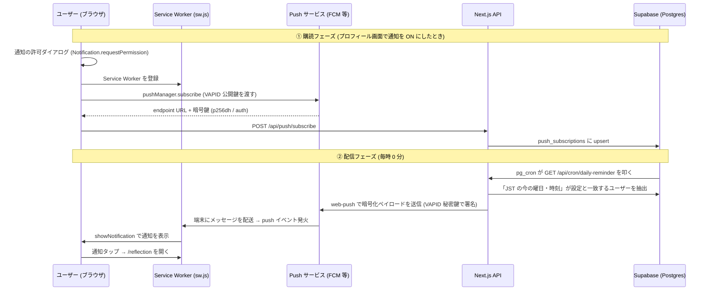

# 始めに

現在個人開発で運用しているアプリに、
「ReflectHub」という、
KPTやYWTなどのフレームワークを使って、
振り返りを行えるアプリがあります。

https://reflecthub.vercel.app/

このアプリは、
私が振り返りをしているものの、
一週間に1回は地味に忘れてしまうので、
通知機能が欲しいと考えていたところから作成されました。
(↓よければ下記記事もご覧ください)

https://qiita.com/hiiragi_en17/items/fdc81f273f742e71ced1

去年の12月にアプリ自体をリリースして、
ようやく半年くらい経ってから、
通知機能が付けられたので、
今回はその機能に関してどのように実装したか深掘りしたいと思います！

# 使用技術

| 役割 | 技術 |
| --- | --- |
| フロントエンド / API | Next.js (App Router) |
| アプリ化 (PWA) | Web App Manifest + Service Worker |
| オフライン対応 | Service Worker のキャッシュ戦略 (`public/sw.js`) |
| 通知の受信 | Service Worker + Web Push API |
| 通知の送信 | `web-push` ライブラリ (Node.js) + VAPID |
| データ保存 | Supabase (PostgreSQL) + RLS |
| 定期実行 | Supabase pg_cron + pg_net + Vault |

この通知は単体で成り立っているわけではなく、
PWA (Progressive Web App) の仕組みの上に載っています。
特にiPhone / iPadでは「アプリをホーム画面に追加する」ことが
通知を受け取る前提条件です。

# 第 1 部: PWA とは何か

**PWA (Progressive Web App)** は、
ふつうのWebサイトに「アプリらしさ」を足す技術の総称です。
App StoreやGoogle Playを通さず、
WebのURLからそのままホーム画面にインストールでき、
オフラインでも動き、通知も受け取れます。

PWAを支えるのは主に次の3つです。

1. **Web App Manifest** — アプリの自己紹介ファイル
2. **Service Worker** — 裏で常駐するスクリプト
3. **HTTPS** — 必須の前提 (Service Workerはhttpsでしか動かない)

## ① Web App Manifest — アプリの「設定票」

`public/manifest.json` が、
OSに「このサイトをアプリとして扱うときの見た目・振る舞い」を伝えます。ReflectHubの内容から抜粋します。

```json
{
  "name": "ReflectHub - 3分で始める週次振り返り",
  "short_name": "ReflectHub",       // ホーム画面のアイコン下に出る短い名前
  "start_url": "/dashboard",         // アプリ起動時に開くページ
  "scope": "/",
  "display": "standalone",           // ブラウザのアドレスバーを隠し、アプリ風に起動
  "theme_color": "#0a0a0a",          // OS のタイトルバー等の色
  "background_color": "#ffffff",     // 起動時スプラッシュの背景色
  "icons": [ /* 192〜512px + maskable */ ],
}
```

押さえておきたい項目:

- **`display: "standalone"`** — これが「アプリらしさ」の核。ブラウザのUI (アドレスバー・タブ) を消して、独立したアプリ画面として起動します。
- **`icons` の `maskable`** — Androidの丸型・角丸などデバイスごとのアイコン形状に切り抜かれても崩れない専用アイコン。ReflectHubは `icon-maskable-512.png` を別に用意しています。
- **`shortcuts`** — アイコン長押しで出るクイックメニュー (「新しい振り返り」「ダッシュボード」)。ただし **iOS は `shortcuts` 非対応** で、Android / デスクトップChrome向けの機能です。

このmanifestは `src/app/layout.tsx` の `manifest: "/manifest.json"` で `<head>` に登録されます。

## ② Service Worker — 裏で常駐する「受付係」

Service Worker (`public/sw.js`) は、
**ページを閉じていてもブラウザが管理する別スレッドで動く JavaScript** です。
ネットワーク通信を横取りしたり、プッシュ通知を受け取ったりできる、
PWAの心臓部です。

### そもそも Service Worker とは — W3C が定めた Web 標準

Service Workerは、**W3C が策定した公式の Web 標準 API** です。
だからChrome・Safari・Firefoxなど各ブラウザが共通で実装しています。

理解のうえで大事なのは、**「スクリプトの中身は自分で書くが、それを Worker として動かすのはブラウザ」** という点です。

| 担当 | 誰がやるか |
| --- | --- |
| SW の中身 (キャッシュ戦略・通知処理) を書く | **開発者** (`public/sw.js`) |
| SW を起動・常駐・再起動し、イベントを発火する | **ブラウザ** |

開発者は「こういう時にこう振る舞え」というルールブックを書いて `navigator.serviceWorker.register()` でブラウザに預けるだけ。
いつ起こすか・どう常駐させるかはブラウザが管理します。
だから通知はタブを閉じていても届きます。

### 普通の Worker (Web Worker) との違い

名前が似ていますが、目的も寿命も別物です。

| 観点 | Web Worker (普通の Worker) | Service Worker |
| --- | --- | --- |
| 主な用途 | 重い計算を別スレッドで回す | 通信の横取り・キャッシュ・通知 |
| 起動 | ページが `new Worker()` で生成 | ブラウザに登録して常駐させる |
| 寿命 | ページを閉じると**死ぬ** | ページを閉じても**生きる** (必要時に起こされる) |
| タブとの関係 | そのページ専用 (1 対 1) | 同一サイトの全タブで共有 (1 対多) |
| 他リクエストの傍受 | できない (自分が `fetch()` を呼ぶのは可) | **できる** (`fetch` イベントでページの通信を横取り) |
| DOM 操作 | 不可 | 不可 |

ReflectHubがオフライン対応と通知を両立できるのは、
この「常駐性」と「通信横取り」という **Service Worker 固有の性質** のおかげです。Web Workerでは実現できません。
 (ページが消えればWorkerも消えるため)

### ライフサイクル: install → activate → 稼働

SWには決まった一生があります。
ReflectHubのコードで追ってみます。

**① install — 事前準備**:
オフライン起動に最低限必要なファイルを先読みキャッシュします。
`event.waitUntil()` は「このPromiseが終わるまでinstallを完了扱いにするな」という指示で、
非同期処理は必ずこれで包みます。
 (SWはイベント処理が終わると眠らされるため)

```js
self.addEventListener('install', (event) => {
  event.waitUntil((async () => {
    const cache = await caches.open(STATIC_CACHE);
    // 1 つの URL が 404 でも install 全体を落とさないよう個別に try/catch
    await Promise.all(PRECACHE_URLS.map((url) => cache.add(url).catch(() => {})));
    await self.skipWaiting();
  })());
});
```

**② activate — 掃除**: 古いバージョンのキャッシュを削除します。`CACHE_VERSION` を上げるとキャッシュ名が変わり、
この掃除ロジックで旧版が消えます。
**バージョン文字列を上げるだけでキャッシュを一新できる**設計です。

**③ 稼働**: 有効化されたSWは普段眠っていて、
`fetch` / `push` / `notificationclick`
 などのイベントが来たときだけ起こされて処理します。

### 制約とつまずきポイント

| 落とし穴 | ReflectHub での対策 |
| --- | --- |
| 更新が反映されない | `skipWaiting()` + `clients.claim()` + `SKIP_WAITING` メッセージ |
| 非同期処理が途中で切れる | `event.waitUntil()` で必ず包む |
| DOM を触れずエラー | SW は DOM 不可。ページとは `postMessage` で通信 |
| HTTPS でしか動かない | 本番は https (開発は localhost が例外) |
| 開発中に古い画面が出る | 開発環境では登録しない (`isProd` ガード) |

**役割: プッシュ通知の受信**

`sw.js` が `push` イベントで通知を表示し、
`notificationclick` でアプリを開きます。
詳細は第3部で扱いますが、**キャッシュも通知も 1 つの Service Worker が担っている**ことを覚えておいてください。

登録は `src/lib/sw/register.ts` が担当し、次の配慮がされています。

- **本番環境でのみ登録** (開発時はNext.jsのHMRと競合し、キャッシュ由来の不可解な挙動を招くため)
- 新バージョンを検出したら `SKIP_WAITING` を送って自動更新

## ③ インストール導線 — ブラウザ差の吸収がいちばんの難所

「インストールできますよ」とユーザーに促すUIは、
PWAで最も厄介な部分です。**ブラウザによってやり方が全く違う**からです。ReflectHubは `src/hooks/useInstallPrompt.ts` で吸収しています。

**Chrome / Edge (Chromium 系) の場合**

ブラウザが `beforeinstallprompt` イベントを自動で発火します。ReflectHubはこれを `preventDefault()` で保持し、自前の「インストール」ボタンから任意のタイミングで起動します。

```ts
window.addEventListener('beforeinstallprompt', (e) => {
  e.preventDefault();        // ブラウザ標準の表示を止める
  setDeferredPrompt(e);      // イベントを保存しておく
});
// ユーザーがボタンを押したら → deferredPrompt.prompt()
```

**iOS / iPadOS の場合** (Safariに限らずiOS上の全ブラウザ = WebKit)

`beforeinstallprompt` が**そもそも来ません**。iOSはJSからインストールを起動できず、ユーザーが手動で「共有ボタン → ホーム画面に追加」する必要があります。そこで `src/components/common/InstallPrompt.tsx` は、iOSを検出したら**手順を絵つきで案内する UI** に切り替えます。

iOS判定 (`src/lib/pwa/standalone.ts`) には一工夫あり、iPadOS 13+ はUAが "Macintosh" を名乗るため、`maxTouchPoints > 1` (タッチ対応か) を併用して見分けています。

**共通の配慮**

- 一度「あとで」を押されたら **14 日間のクールダウン** (localStorage記録) で再表示を抑制。しつこくしない。
- すでにstandalone起動済み (インストール済み) ならUIを一切出さない。

## 理由 2: iOS では PWA インストールが通知の「必須条件」

これは実装でハマりやすい重要ポイントです。
**iOS (iPhone / iPad) では、ホーム画面に追加した PWA でしか Web Push を受け取れません** (iOS 16.4以降)。
Safariのタブで開いているだけでは、
どれだけ設定しても通知は一切来ません。

この制約がUI設計に直接表れています。
通知設定画面は、未インストールのユーザーに対し、
OSによって案内の温度感を変えます。

```tsx
{isIOS ? (
  // iOS: 通知には「必須」なので amber で強調
  <p>📱 通知を受け取るにはインストールが必要です</p>
) : (
  // Android / PC: 任意なので gray で「おすすめ」
  <p>📱 通知を受け取るならアプリのインストール（PWA）がおすすめです</p>
)}
```

コード側の意図も明快です。`src/lib/pwa/standalone.ts` の冒頭コメントは、PWA判定関数が**通知のために存在する**ことを明言しています。

Web PushはService Workerを必要とし、
特にiOS/iPadOSでは「ホーム画面に追加したPWA (standalone)」
でのみ通知を受け取れる。
通知設定UIやインストール促しUIで、
この状態に応じた案内を出すために使う。

**まとめると**: PWA化は、iOSで通知を動かすための前提条件です。
だからReflectHubは「まずインストールを促し、
その上で通知を設定させる」導線になっています。
この土台を理解したうえで、いよいよ通知の中身に進みます。

# 第 3 部: 通知が届く仕組み

## 大前提: Web Push の登場人物は「4 者」いる

Web Pushというと「サーバーがブラウザに直接通知を送る」
イメージを持ちがちですが、実際には **4 者** が関わります。

```text
[アプリのサーバー] → [Push サービス] → [ブラウザ/OS] → [Service Worker] → 通知表示
```

1. **アプリのサーバー** (ReflectHubのNext.js API): 通知を「送りたい」側
2. **Push サービス**: Google (FCM)・Apple・Mozillaなどブラウザベンダーが運営する中継サーバー。アプリはここにHTTPリクエストを送るだけ
3. **ブラウザ / OS**: Pushサービスと常時つながっていて、メッセージが来たらService Workerを起こす
4. **Service Worker**: 第1部で登場した、
ページを閉じても動くスクリプト。受け取ったメッセージを通知として表示する

アプリのサーバーは端末に直接触れません。
「この端末に届けてください」という宛先 (**エンドポイント URL**) をPushサービスからもらい、そこへ送るのがポイントです。

## 全体の流れ

通知機能は大きく **「① 購読 (受け取る準備)」** と
 **「② 配信 (実際に送る)」** の2フェーズにわかれます。



## ① 購読フェーズ: 「通知を受け取る準備」

### 1. ユーザーが曜日・時刻を選んで保存する

プロフィール画面の通知設定で、ユーザーは

- **通知する曜日** (OFF / 日〜土)
- **通知する時刻** (0:00〜23:00、日本時間)

を選びます。「保存」を押すと、OFF以外なら次のステップに進みます。


### 2. ブラウザに通知の許可をもらう

まず対応チェックと許可リクエストを行います。

```ts
// 対応チェック: この 3 つが揃っていないと Web Push は使えない
'serviceWorker' in navigator && 'PushManager' in window && 'Notification' in window

// ユーザーに「通知を許可しますか?」ダイアログを出す
const result = await Notification.requestPermission(); // 'granted' なら OK
```

### 3. Service Worker を登録し、Push サービスを「購読」する

許可が取れたら `/sw.js` をService Workerとして登録し、
**Push サービスへの購読** を行います。
第2部で触れたとおり、
通知はここでPWAのService Workerを使います。

```ts
const registration = await navigator.serviceWorker.register('/sw.js');
// VAPID 公開鍵 (base64url 文字列) は Uint8Array に変換して渡す。
// 仕様上は文字列も許容されるが、ブラウザ実装差があるため変換が実務の定番。
const applicationServerKey = urlBase64ToUint8Array(vapidPublicKey);
const subscription = await registration.pushManager.subscribe({
  userVisibleOnly: true,          // 「通知は必ずユーザーに見せる」宣言 (必須)
  applicationServerKey,           // VAPID 公開鍵 (Uint8Array)
});
```

`subscribe()` を呼ぶと、ブラウザが裏でPushサービスと通信し、**PushSubscription** が返ってきます。どのPushサービスになるかはブラウザ依存で、`endpoint` のURLに表れます。

- Chrome / Edge → FCM: `https://fcm.googleapis.com/fcm/send/...`
- Safari (Apple) → APNsベース: `https://web.push.apple.com/...`
- Firefox → Mozilla autopush: `https://updates.push.services.mozilla.com/...`

返ってくる中身は3つ。

| フィールド | 意味 |
| --- | --- |
| `endpoint` | この端末専用の「宛先 URL」。ここに POST すると端末にメッセージが届く |
| `p256dh` | ペイロード暗号化用の公開鍵 (楕円曲線 P-256) |
| `auth` | 暗号化用の認証シークレット |

`p256dh` と `auth` は、**Push サービス (Google 等) にも通知の中身を読ませない** ためのエンドツーエンド暗号化 (RFC 8291) に使われます。

### 4. サーバーに購読情報を保存する

取得した購読情報を `POST /api/push/subscribe` に送り、
Supabaseの `push_subscriptions` テーブルにupsertします。

```sql
CREATE TABLE push_subscriptions (
  id UUID PRIMARY KEY,
  user_id UUID NOT NULL,       -- 誰の端末か
  endpoint TEXT NOT NULL,      -- 宛先 URL
  p256dh TEXT NOT NULL,        -- 暗号化用公開鍵
  auth TEXT NOT NULL,          -- 認証シークレット
  is_active BOOLEAN DEFAULT true,
  updated_at TIMESTAMPTZ       -- 「最後に ON にした端末」判定に使う
);
-- (user_id, endpoint) でユニーク → 同じ端末を二重登録しない
```

- **RLS (Row Level Security)** で「自分の行しか読み書きできない」ように保護
- `(user_id, endpoint)` のユニーク制約 + upsertにより、同じ端末で何度ONにしても行は1つ
- upsertのたびにトリガーで `updated_at` が更新される → 後述の「最後にONにした端末に送る」判定に使う

曜日・時刻の設定自体は `user_preferences.notification_preferences` (JSONB) に保存されます。

```json
{ "reminder_weekday": 3, "reminder_hour": 21 }  // 水曜 21:00 (JST)
```

### 保存順序のこだわり (DB と購読状態をずらさない)

ブラウザの購読操作とDB更新はアトミックにできないため、
失敗時に「誤配信」が起きない順序にしています。

- **ON にするとき**: 先に購読を確立 → 成功したらDBに曜日を保存 (購読がないのにONが保存される事故を防ぐ)
- **OFF にするとき**: 先にDBをOFFに → その後ブラウザの購読を解除 (解除に失敗してもDBがOFFなので配信されない)

## ② 配信フェーズ: 「毎時 0 分に動くリマインダー」

### 5. pg_cron が毎時 0 分に API を叩く

定期実行には **Supabase の pg_cron** を使っています。

```sql
select cron.schedule(
  'daily-reminder',
  '0 * * * *',  -- 毎時 0 分
  $job$
  select net.http_get(
    url := (select decrypted_secret from vault.decrypted_secrets
            where name = 'reminder_endpoint_url'),
    headers := jsonb_build_object('Authorization',
      'Bearer ' || (select decrypted_secret from vault.decrypted_secrets
                    where name = 'cron_secret')),
    timeout_milliseconds := 30000
  );
  $job$
);
```

ポイント:

- **なぜ Vercel Cron ではなく pg_cron?** — 理由は2つあり、
どちらもVercelの **Hobby (無料) プラン** の制約です。
  - **① 無料プランでは毎時実行がそもそも不可能** — HobbyプランのCronは1日1回まで。`0 * * * *` (毎時) のような定義はデプロイ時にエラーになります。ユーザーごとに配信時刻が違うReflectHubは毎時起動が前提なので、この時点でHobbyでは要件を満たせません。
  - **② 実行時刻もブレる** — Hobbyプランは負荷分散のため、指定した時間内の任意のタイミングで起動します (`0 8 * * *` なら08:00:00〜08:59:59のどこか)。そのため「11時ちょうど」を狙っても中途半端な時刻に通知が来ます。(Pro以上のプランなら指定した分のなかで起動するため、分単位では正確です。)
  - pg_cronはPostgres内部のワーカーが毎分スケジュールを評価するので、**指定した分ちょうど** に、毎時でも動きます。
  Supabaseの無料プランで使えて追加コストはゼロ。
- **pg_net** でDBから外部HTTP (自アプリのAPI) を叩く
- URLとシークレットは **Supabase Vault** に暗号化保存し、SQLに平文で書かない
- タイムアウトはデフォルト2秒 → コールドスタート対策で30秒に延長
- ユーザーごとに配信時刻が違うので **毎時** 起動し、「誰に送るか」の判定はアプリ側で行う。対象0件の時間帯は即終了するだけ

### 6. API が cron 認証と配信対象の絞り込みを行う

`GET /api/cron/daily-reminder` はまず
`Authorization: Bearer ${CRON_SECRET}` を検証します。
誰でも叩けると通知を乱発できてしまうためです。

次に `getReminderTargets()`が配信対象を決めます。

1. **JST での「今」の曜日と時刻** を `Intl.DateTimeFormat` で計算 (サーバーのタイムゾーンに依存しない)
2. DBクエリで `reminder_weekday` = 今の曜日、かつ `reminder_hour` = 今の時刻のユーザーを抽出 (JSONBの `->>` 演算子で絞り込み)
3. **同日中に通知済みのユーザーはスキップ** — `last_notified_at` がJSTで今日ならスキップ (二重通知防止)
4. 該当ユーザーの有効な (`is_active = true`) 購読を取得し、**`updated_at` の新しい順** に並べる

### 7. 「最後に ON にした端末」1 台だけに送る

1人がパソコン・スマートフォンなど複数端末で購読していることがありますが、
全端末に送ると冗長です。そこで `sendPushToFirstAvailable()` は次のように動きます。

- **`updated_at` が最新の端末 (= 最後に通知を ON にした端末) から順に 1 件ずつ試す**
- 1件成功したらそこで終了 (通知は1台にだけ届く)
- 先頭の購読が **失効 (HTTP 404/410)** していた場合のみ、次に新しい端末へフォールバック
- ネットワークエラーや500など「失効以外の失敗」なら打ち切り (他端末でも失敗する見込みが高いため)

### 8. web-push ライブラリが暗号化して Push サービスへ送信する

実際の送信は `web-push` ライブラリが担います。
裏では次のことが起きています。

1. ペイロード (JSON) を購読時の `p256dh` / `auth` 鍵で
 **暗号化** (RFC 8291) — Pushサービスにも中身は読めない
2. **VAPID 秘密鍵で署名した JWT** をヘッダーに付与 (RFC 8292)
—「この通知は正規のReflectHubサーバーからです」という証明
3. 購読の `endpoint` URLへHTTP POST → Pushサービスが端末へ配送

送るペイロードはこれだけです。

```json
{
  "title": "ReflectHub - 振り返りの時間です",
  "body": "今日の出来事を 1 つだけでも書き留めてみませんか？",
  "url": "/reflection",
  "tag": "reflecthub-daily-reminder"
}
```

#### VAPID とは?

VAPID (Voluntary Application Server Identification) は、**「どのサーバーが通知を送っているか」を Push サービスに証明する公開鍵ペア** です。

- **公開鍵**: ブラウザに渡して購読時に登録。「この鍵の持ち主だけが私に通知を送れる」と紐づく
- **秘密鍵**: サーバーだけが保持。送信時のJWT署名に使う

鍵が一致しない送信はPushサービスに拒否されるので、
endpoint URLが漏れても第三者は通知を送れません。

### 9. Service Worker が通知を表示する

Pushサービスからメッセージが届くと、
**アプリを開いていなくても** ブラウザがService Workerを起こし、`push` イベントが発火します (`public/sw.js`)。
ここで、第1部でオフラインキャッシュを担っていたのと同じ
Service Workerが、今度は通知の表示を担当します。

```js
self.addEventListener('push', (event) => {
  // ペイロード無しの push が来ると event.data は null になり得る。
  // そのまま .json() を呼ぶと例外になるので、必ずガードする。
  let payload = {};
  if (event.data) {
    try {
      payload = event.data.json();
    } catch {
      payload = { title: 'ReflectHub', body: event.data.text() };
    }
  }
  event.waitUntil(
    self.registration.showNotification(payload.title || 'ReflectHub', {
      body: payload.body,
      icon: payload.icon || '/favicon.ico',
      data: { url: payload.url || '/dashboard' },
      tag: payload.tag,       // 同じ tag の通知は上書きされ、積み上がらない
    }),
  );
});
```

上記のとおり `event.data` のnullガードは実コードにも入っています。

通知をタップすると `notificationclick` イベントで対象
URL (`/reflection`) を開きます。
すでにそのページのタブが開いていれば **フォーカス** し、
なければ新しく開きます。

```js
self.addEventListener('notificationclick', (event) => {
  event.notification.close();
  // 開いているタブがあれば focus、なければ openWindow
});
```


### 10. 後片付け: 失効処理と重複防止

配信後、cronエンドポイントは以下を行います。

- **失効した購読 (404/410) を `is_active = false` に更新** — アンインストールや購読期限切れの端末には二度と送らない
  - 注意: **401 は失効扱いにしない**。401はサーバー側のVAPID設定ミスの可能性が高く、失効扱いにすると鍵ミス1つで全ユーザーの購読が無効化されてしまうため (RFC 8030では404/410のみが購読失効を意味する)
- **配信成功したユーザーの `last_notified_at` を更新** — 同日中の再通知を防ぐ
- 対象がいたのに **1 件も成功しなかった場合は HTTP 500 を返す** — VAPID設定ミスなどのシステム障害を監視で検知できるようにする

## まとめ: PWA から通知まで一気通貫

PWAと通知は、Service Workerという共通の土台でつながっています。
全体を振り返ると次のとおりです。

**PWA が土台を用意する (第 1〜2 部)**

1. Manifestでアプリの見た目・起動方法を定義
2. Service Workerを登録 (オフラインキャッシュ + 通知受信を兼ねる)
3. ブラウザ差を吸収してインストールを促す (iOSは手動案内)
4. iOSではPWAインストールが通知の必須条件

**その上で通知が動く (第 3 部)**

5. ユーザーが曜日・時刻を選び、通知許可を取得
6. Service Worker登録 + Pushサービスを購読 (endpointと暗号鍵を取得)
7. 購読情報をSupabaseに保存
8. pg_cronが毎時0分に配信APIを起動
9. 「JSTの今の曜日・時刻」に一致するユーザーを抽出 (通知済みはスキップ)
10. 最後にONにした端末1台へ、web-pushが暗号化 + VAPID署名して送信
11. Service Workerが通知を表示、タップで `/reflection` へ
12. 失効購読の無効化と `last_notified_at` 更新で後片付け

# 最後に

ようやく通知機能をつけられたことで、
このアプリでの振り返りを着実に行っていけそうで
よかったと思っています！
もし振り返りに興味があれば、
ぜひアプリを使ってみてください。
今振り返りフレームワークはこれだけ用意しているので、
自分に合うフレームワークを使って、
振り返りを手軽に始められるのではないかと思います！
また今後もアップデートしていく予定です。


https://reflecthub.vercel.app/

GitHubのページは下記になります。

https://github.com/hiiragi17/ReflectHub

それではここまで読んでいただきありがとうございました。
誰かの参考になれば幸いです。

# 参考文献

この記事は以下の記事を参考にして執筆させていただきました。

https://www.w3.org/TR/service-workers/

https://developer.mozilla.org/ja/docs/Web/API/Service_Worker_API

https://www.w3.org/TR/appmanifest/

https://fetch.spec.whatwg.org/

https://www.w3.org/TR/push-api/

https://web.dev/learn/pwa/service-workers/

https://caniuse.com/serviceworkers
